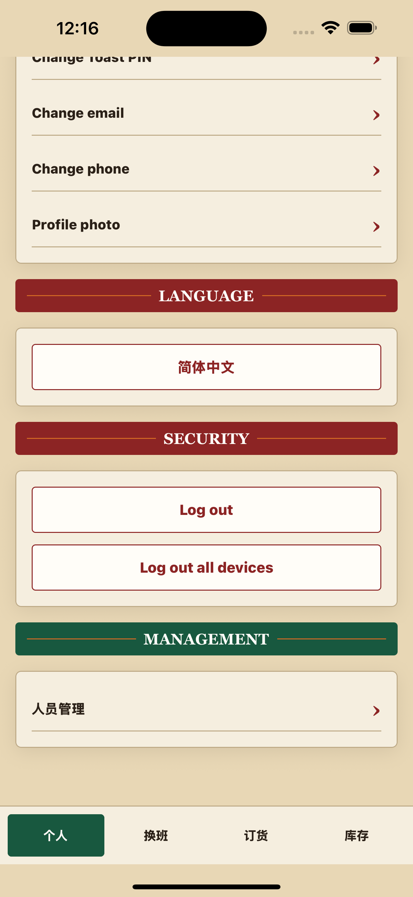
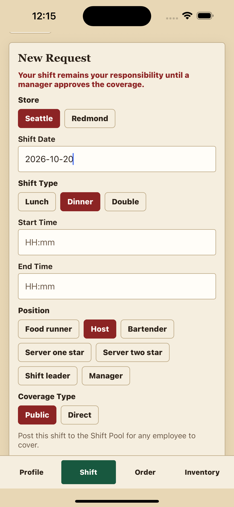
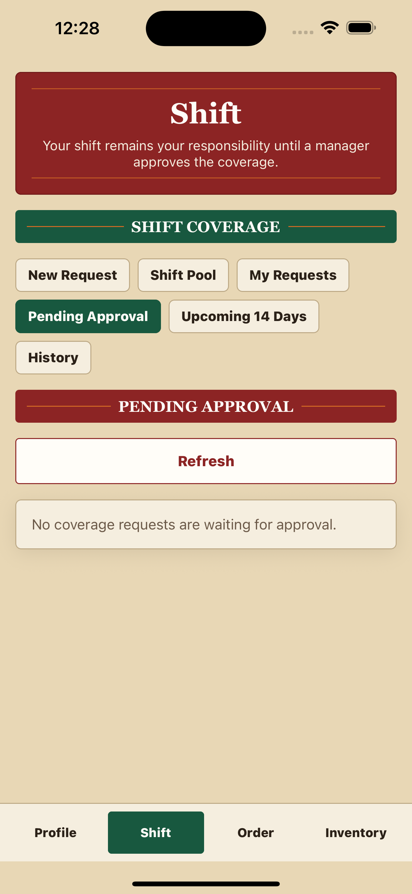
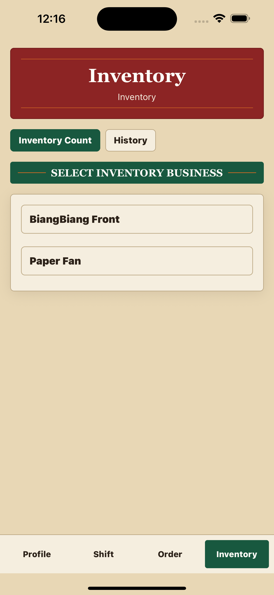
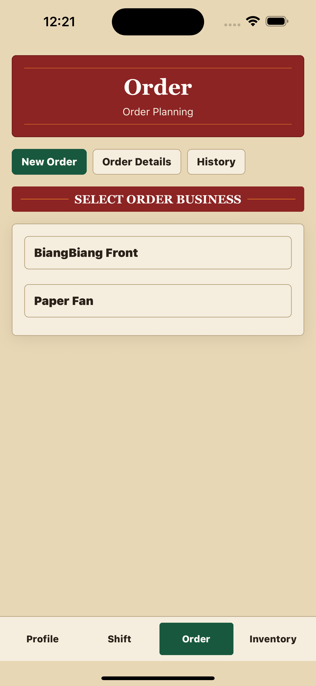
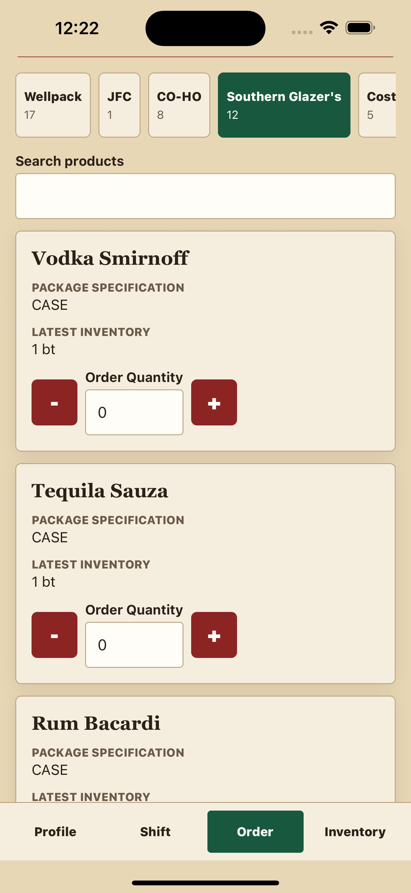
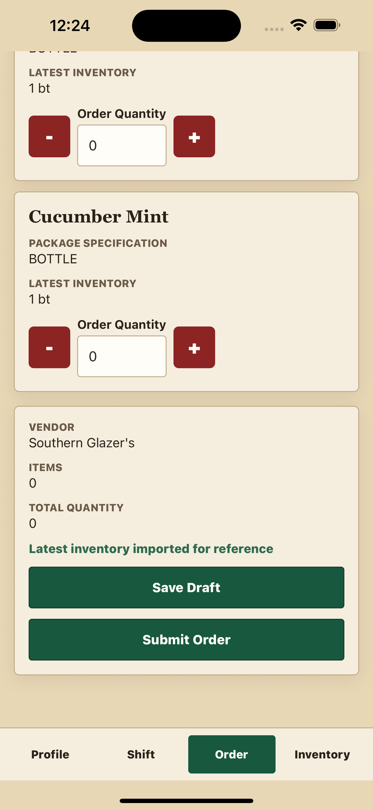
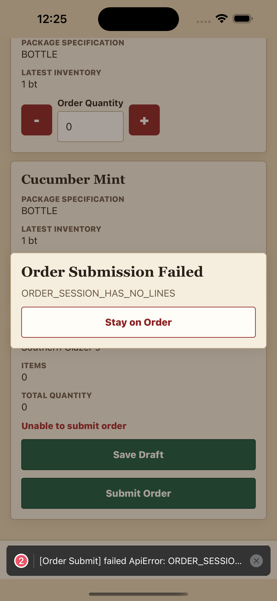
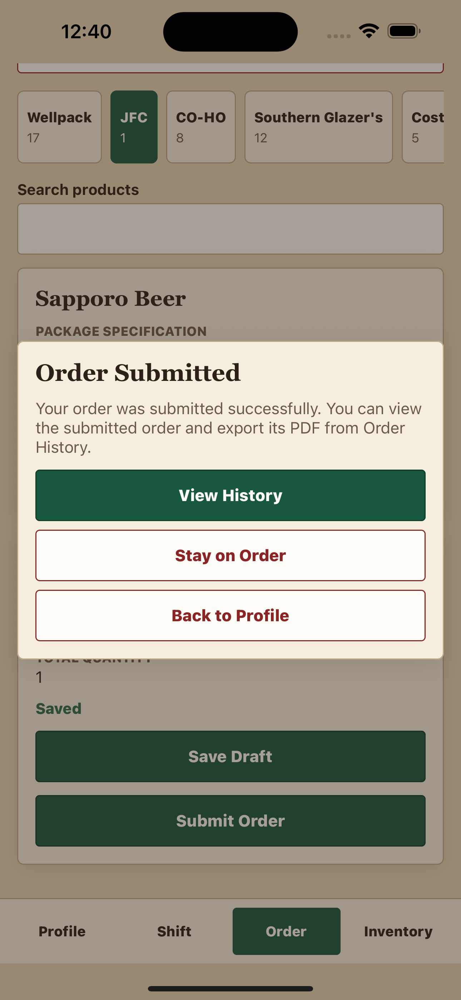
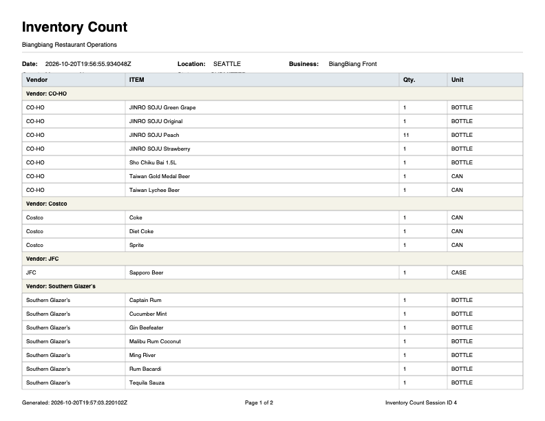

# Biangbiang Management (Restaurant Ops)

First production feature scaffold for a two-location restaurant operations app.

See [docs/account-auth-foundation.md](docs/account-auth-foundation.md) for setup, bootstrap, API, and security notes.

## Tech stack

- **Mobile:** Expo, React Native, TypeScript, Expo Router, TanStack Query, React Hook Form, Zod, and Expo SecureStore.
- **Backend:** Java 21, Spring Boot, Spring Security, Spring Data JPA, Bean Validation, and JWT authentication.
- **Database and API:** MySQL, Flyway migrations, and OpenAPI.

## Feature screenshots

Restaurant operations for Seattle and Redmond: profile settings, shift coverage, inventory counts, order planning, and PDF reports.

### 1. Profile and language settings

Account settings and English / Simplified Chinese language controls.

  

### 2. Shift coverage

Shift coverage requests with store, date, position, public or direct coverage options, and a manager approval queue.

| Coverage request form | Manager queue: empty state |
| --- | --- |
|  |  |

### 3. Inventory counts

Inventory counts for BiangBiang Front and Paper Fan, with business selection and history.

  

### 4. Order planning

Order planning with business selection, vendor groups, inventory references, quantity controls, draft saving, and submission.

| Select a business | Inventory reference and quantities |
| --- | --- |
|  |  |

| Draft and submit controls | Submission feedback |
| --- | --- |
|  |  |

  

### 5. PDF reports

  

